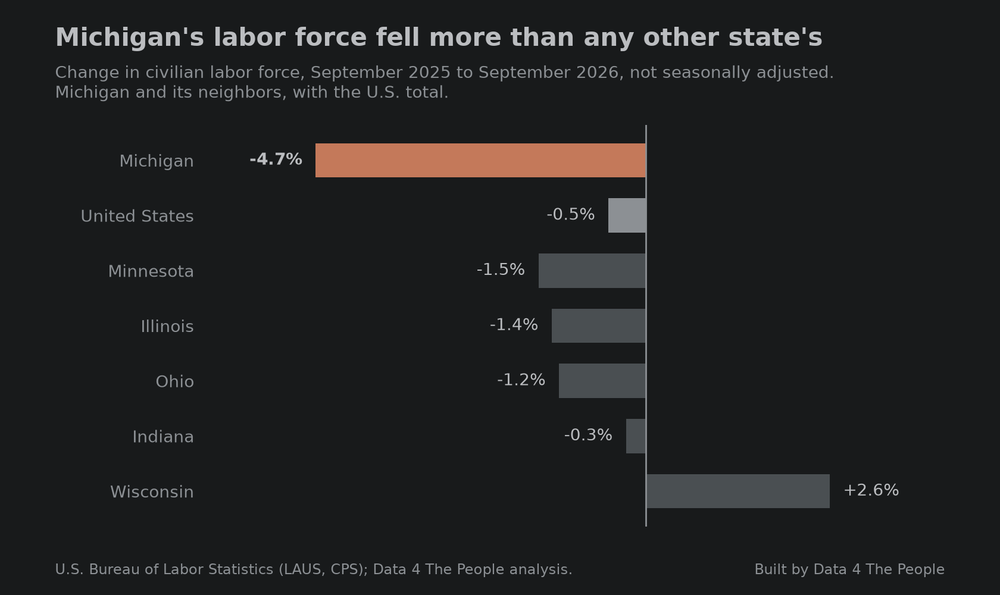

# Where did Michigan's workers go?

<!-- First cut by Claude at Eric's request (Nov 3, 2026): charts and facts only. Eric adds color. -->

## The national picture

The Bureau of Labor Statistics (BLS) posted county labor force data through September 2026 on October 28, 2026. In September, 1,132 of 3,214 U.S. counties and Puerto Rico municipios were in structural labor force loss. That means their labor force was more than 10% below the same month 20 years earlier. It works out to 35.2% of all counties.

On the 3,207 counties with data in both years, the count rose by 40 from September 2025. That is 129 counties entering structural loss and 89 leaving it.

The chart below shows the share of counties in structural loss for every September since 2012. September 2026 is the third highest, behind 2022 (36.2%) and 2021 (35.5%).

*Structural labor force loss, every September since 2012. Source: U.S. Bureau of Labor Statistics (LAUS); Data 4 The People analysis.*

## Half of the increase is in Michigan

One state accounts for half of that net increase. In Michigan, 20 counties entered structural loss in the past year and none left. The next largest net gains were in Minnesota (10), Oklahoma (9) and Tennessee (9).

Michigan now has 53 of its 83 counties in structural loss, up from 33 a year earlier. The map below shows which counties entered in the past year, which were already there, and which are not in structural loss.

*Michigan counties by labor force status, September 2026. Source: U.S. Bureau of Labor Statistics (LAUS); Data 4 The People analysis.*

## A statewide drop

Michigan's labor force fell 4.7% from September 2025 to September 2026, from 5,029,694 to 4,791,578. That is the largest drop of any state. The U.S. labor force fell 0.5% over the same year. Among Michigan's neighbors, Ohio fell 1.2%, Illinois 1.4%, Minnesota 1.5% and Indiana 0.3%, while Wisconsin rose 2.6%. The chart below compares them.

*Michigan's labor force fell more than any other state's. Source: U.S. Bureau of Labor Statistics (LAUS, CPS); Data 4 The People analysis.*

BLS builds its county numbers so that they add up to the state total. When the state number falls this much, the counties fall with it. 19 of the 20 counties that entered structural loss fell faster than the state as a whole.

Because each county is compared with the same month 20 years earlier, we also checked whether any of the 20 crossed the line only because its starting point moved from September 2005 to September 2006. None did.

## Outside the Detroit area

The decline is not spread evenly. The six counties of the Detroit metro area (Wayne, Oakland, Macomb, Livingston, Lapeer and St. Clair) grew 0.6% together. The other 77 counties fell 8.7%, from 2,867,647 to 2,617,300.

Compared with the same month a year earlier, the 77 counties were down 3.6% in January, 6.6% in April and 8.7% in September. The drop eased to about 7% in July and August before reaching its largest point in September. The chart below shows each month for both areas.

*Michigan's labor force drop is outside the Detroit metro. Source: U.S. Bureau of Labor Statistics (LAUS); Data 4 The People analysis.*

Ohio does not show the same pattern. BLS also estimates Cleveland and the rest of Ohio as separate areas. Outside Ohio's six metro areas of 500,000 or more people, the labor force fell 1.2% from September 2025 to September 2026. Outside Michigan's two, Detroit and Grand Rapids, it fell 8.7%. The chart below shows each month.

*Michigan fell far more than Ohio outside the big metros. Source: U.S. Bureau of Labor Statistics (LAUS); OMB 2023 metro areas; Data 4 The People analysis.*

This split matches how BLS builds its estimates. BLS estimates the Detroit metro area and the rest of Michigan as two separate areas, then divides each total among its counties. All 20 counties that entered structural loss are outside the Detroit metro, so they move with one shared estimate.

## Job counts do not show the same drop

BLS also counts jobs, through a monthly survey of employers. The two measures count different things. The labor force counts people where they live, including the self-employed. Payroll jobs count nonfarm jobs where the employer is, and a person with two jobs counts twice.

From September 2025 to September 2026, Michigan's payroll jobs were about flat (up 0.04%). Manufacturing jobs fell 0.3%.

The next chart compares employed Michigan residents with payroll jobs at Michigan employers since January 2025, both seasonally adjusted. Employed residents fell 4.5%. Payroll jobs rose 0.2%.

*Fewer Michiganders are working, but payroll jobs are not falling. Source: U.S. Bureau of Labor Statistics (LAUS, CES); Data 4 The People analysis.*

The gap shows up in participation, not in population. Michigan's labor force participation rate, the share of adults who are working or looking for work, fell from 60.8% in September 2025 to 58.5% in September 2026 (seasonally adjusted). Over the same year, Ohio's fell from 62.3% to 61.2% and the nation's from 62.5% to 61.8%. The chart below shows all three since January 2024.

*Participation fell faster in Michigan than in Ohio or the U.S. Source: U.S. Bureau of Labor Statistics (LAUS, CPS); Data 4 The People analysis.*

The household survey behind these estimates points the same way. Averaged over January to September, it shows about the same number of adults in Michigan as a year earlier (8.23 million in 2025 and 8.24 million in 2026), while the share in the labor force fell from 61.4% to 58.2%. The survey also suggests that adults ages 25 to 54 took part less, from 84.6% to 82.5%, though that change is close to the survey's margin of error. Our confidence in this is lower, because the survey reaches about 1,570 Michigan adults a month. It points in a direction rather than settling the question.

Aging does not appear to account for a drop this fast. Census population estimates show Michigan growing older at a steady pace, which by our rough math lowers the labor force by about 0.5% to 1% a year. The same estimates show Michigan's population aged 25 to 54 grew 0.6% in each of 2024 and 2025.

## Why it is worth watching

We are not trying to explain this drop here. In our view, it is worth keeping an eye on, especially given how much Michigan relies on Canada.

From January to August 2026, Canada bought 38.8% of the goods Michigan exported, compared with 14.3% for the nation as a whole. Canada supplied 25.5% of Michigan's goods imports, compared with 11.2% for the nation.

What to watch next: BLS usually revises the past five years of state and county labor force data early in each calendar year, so the 2026 Michigan figures are expected to be re-estimated in early 2027. The monthly releases between now and then will show whether the drop outside the Detroit area continues.

::: divider

## What this does not tell you

- County labor force figures are model estimates, not direct counts. BLS controls them to a state or area total, so a small county's number is partly a share of a larger estimate.
- The 2026 figures are preliminary and are expected to change in the early-2027 revision.
- The household survey sample for Michigan is small. We use it only for the statewide direction, not for any one age group or region.
- Employed residents and payroll jobs count different things: people where they live versus jobs where they are. They are not expected to match exactly.
- Trade figures are in dollars, not adjusted for inflation. Exports are counted by the state where goods start their trip to the border, which is not always where they were made.
- Seven New Orleans-area parishes have no data for September 2025 because of a gap in 2005 after Hurricane Katrina. That is why the year-over-year comparison uses 3,207 counties.
- This post does not say what caused the drop.

## How we built this

Each county is compared with its own labor force in the same month 20 years earlier, using BLS Local Area Unemployment Statistics (not seasonally adjusted). A county is in structural loss when that change is below -10.0%. Comparisons over time always use the same month. Payroll jobs come from the BLS Current Employment Statistics survey, participation and the household survey from BLS and the Census Bureau's Current Population Survey, aging from Census population estimates, and trade from the Census Bureau's international trade data. Code and method notes are in our [GitHub repository](https://github.com/Data4ThePeople/laus).
